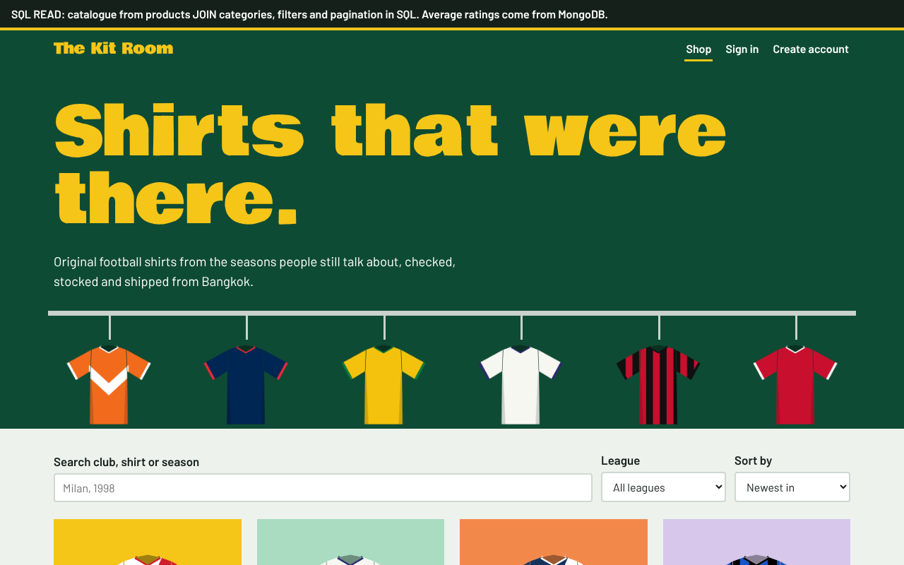
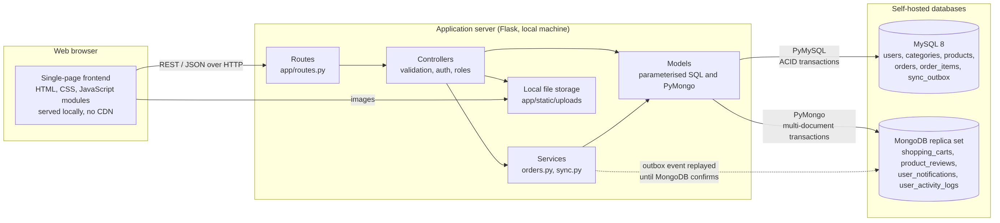
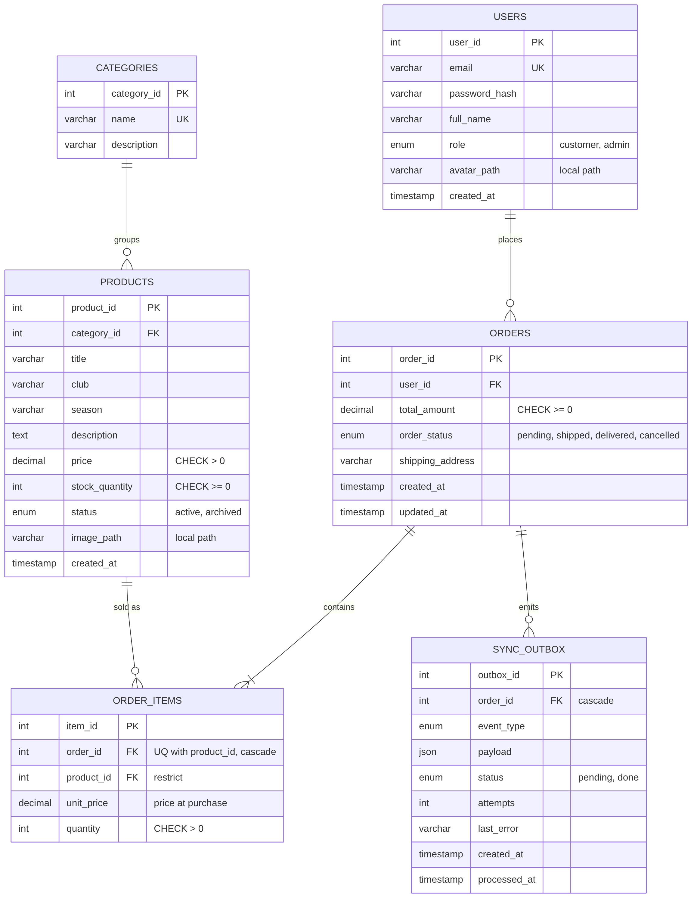
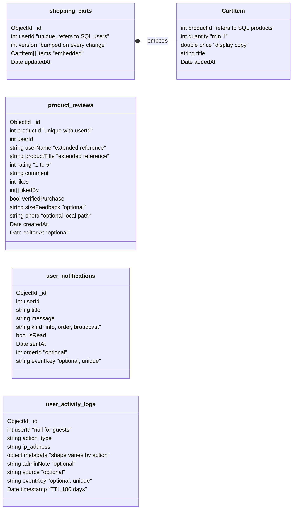
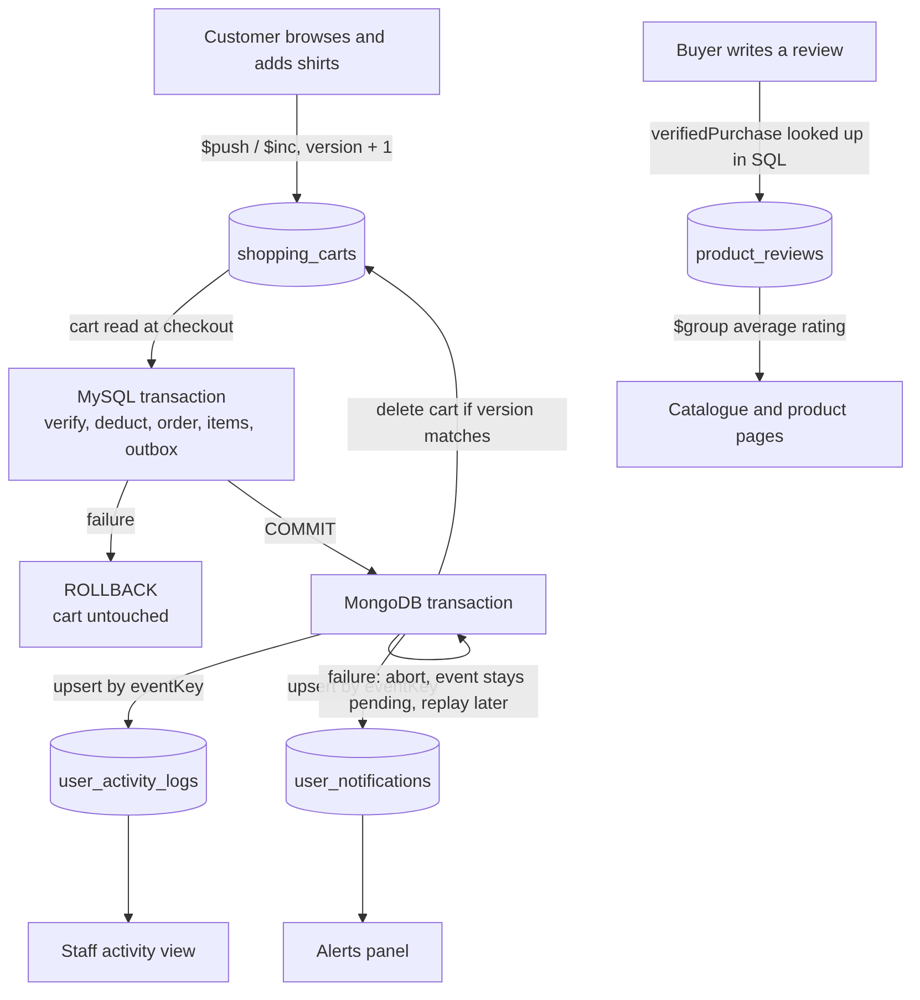
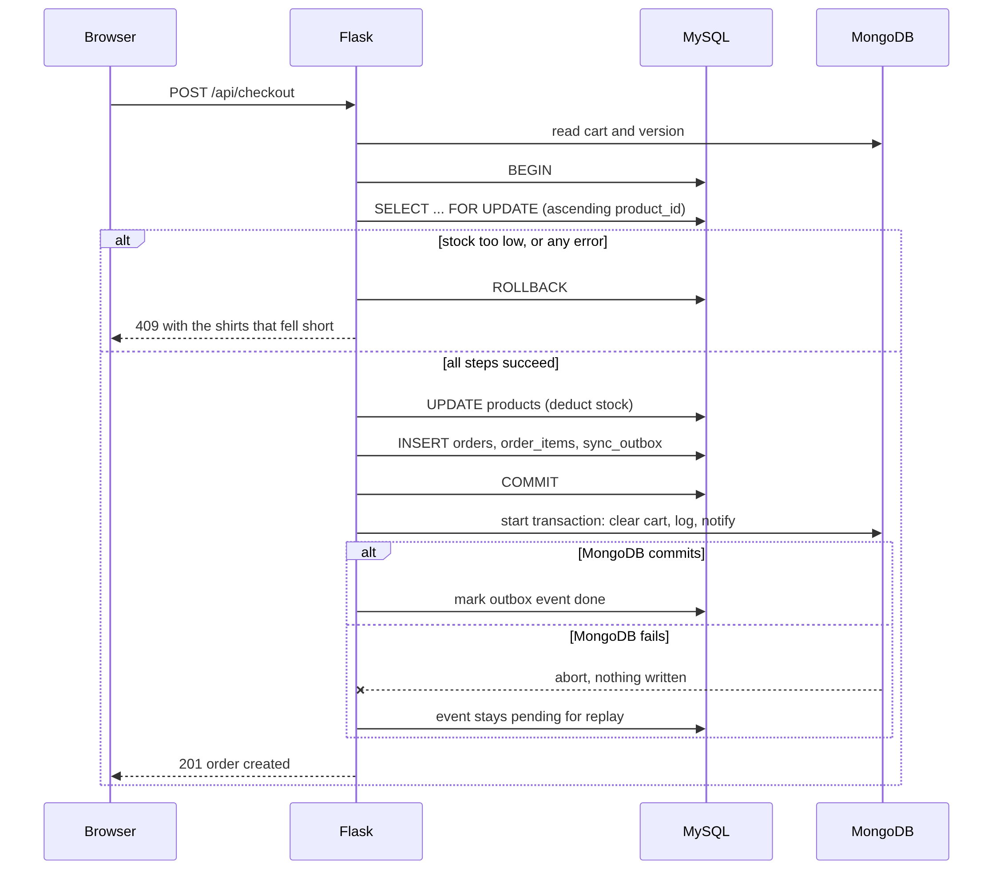

# The Kit Room

A full-stack shop for retro football shirts, built for the Hybrid Database Web Application project of Database Systems (01219231) at Kasetsart University.

MySQL holds what must stay strictly correct: accounts, catalogue, stock and orders. MongoDB holds what changes shape or volume quickly: carts, reviews, notifications and activity logs. Checkout spans both engines without ever losing an order or leaving a half-finished one.



## Tech stack

| Layer | Technology |
|---|---|
| Frontend | HTML, CSS, JavaScript ES modules. Fonts are bundled, nothing loads from a CDN |
| Backend | Python 3.10+, Flask REST API |
| SQL | MySQL 8 (InnoDB), PyMySQL, hand-written parameterised SQL |
| NoSQL | MongoDB 6+ as a replica set, PyMongo |
| Media | Local disk, `app/static/uploads` |
| Tests | pytest integration tests against real MySQL and MongoDB |

The app is self-contained: no external API, cloud database, image host or CDN.

## Setup (Windows, macOS, Linux)

You need Python, MySQL 8 and MongoDB Community Server installed locally.

**1. Create the MySQL database and user.** In MySQL Workbench, run `database/create_database.sql`, or:

```bash
mysql -u root -p < database/create_database.sql
```

**2. Run MongoDB as a replica set.** Multi-document transactions require one, and a single node is enough.

On Windows, open `C:\Program Files\MongoDB\Server\<version>\bin\mongod.cfg` as administrator, add the lines below, then restart the MongoDB service from `services.msc`:

```yaml
replication:
  replSetName: rs0
```

On macOS or Linux you can instead start it directly with `mongod --dbpath ./mongo-data --replSet rs0`.

**3. Install the app.**

```bash
python -m venv .venv
.venv\Scripts\activate            # macOS/Linux: source .venv/bin/activate
pip install -r requirements.txt
copy .env.example .env             # macOS/Linux: cp .env.example .env
python scripts/init_replica_set.py
python manage.py migrate
python manage.py seed
python run.py
```

Open <http://127.0.0.1:5000>. On macOS, AirPlay often holds port 5000: set `PORT=5055` in `.env`.

### Demo accounts

All use the password `KitRoom2026`. They exist only in the local seed data.

| Email | Role |
|---|---|
| `admin@kitroom.test` | Staff, includes the Transaction lab |
| `mali@kitroom.test` | Customer with orders and a cart |
| `arthit@kitroom.test` | Customer |
| `camille@kitroom.test` | Customer |

### Commands

| Command | Effect |
|---|---|
| `python manage.py migrate` | Applies new SQL migrations, creates Mongo collections, validators and indexes |
| `python manage.py seed` | Loads demo data through the real checkout code |
| `python manage.py reset` | Empties both databases and migrates again |
| `python manage.py sync` | Replays pending cross-database events |
| `python -m pytest tests` | Runs the integration tests (uses separate `kitroom_test` databases) |

## Environment variables

| Variable | Default | Purpose |
|---|---|---|
| `SECRET_KEY` | `dev-only-secret` | Signs session cookies. Set your own |
| `FLASK_DEBUG` | `0` | `1` enables debug mode |
| `PORT` | `5000` | HTTP port |
| `MYSQL_HOST`, `MYSQL_PORT` | `127.0.0.1`, `3306` | MySQL server |
| `MYSQL_USER`, `MYSQL_PASSWORD` | `kitroom`, `kitroom_dev` | MySQL account |
| `MYSQL_DATABASE` | `kitroom` | MySQL database |
| `MONGO_URI` | `mongodb://127.0.0.1:27017/?replicaSet=rs0` | MongoDB connection |
| `MONGO_DATABASE` | `kitroom` | MongoDB database |

## Architecture



```
app/
  routes.py        every URL, in one table
  controllers/     HTTP handling, validation, permissions
  services/        multi-step workflows: orders.py, sync.py
  models/          SQL and MongoDB queries
  db.py            connections and the transaction() helper
  static/          frontend, fonts, uploaded media
database/
  migrations/      versioned SQL schema
  seeds/           demo data
  mongo_setup.py   collections, validators, indexes
docs/              diagrams and screenshots
scripts/           tooling
tests/             integration tests
```

## Data design

Why each store: a stock count that drifts costs real money, so stock lives under ACID constraints. A cart is read and written as one unit and has a varying number of lines, so it is one document with embedded items. Reviews and log entries have optional fields that differ per document, which suits a flexible schema.

### SQL: 6 tables, third normal form



Stock and price rules are also `CHECK` constraints, so a bug in the application still cannot store negative stock. `order_items.unit_price` keeps the price paid, so later price changes do not rewrite history.

### NoSQL: 4 collections





Patterns used: embedding (cart items), extended reference (`userName` and `productTitle` copied into reviews and refreshed on rename), `$jsonSchema` validators for the few fields that must hold, a unique index for one review per user per shirt, and a TTL index expiring logs after 180 days.

## CRUD coverage

Every operation is available in the web UI.

| Entity | Engine | Create | Read | Update | Delete |
|---|---|---|---|---|---|
| users | SQL | Register, staff add | Profile, staff list | Profile, password, photo, role | Own account, staff delete |
| categories | SQL | Staff | Filters, staff list | Staff | Staff, blocked if in use |
| products | SQL | Staff, with image | Catalogue, product page | Edit, stock + and − | Staff, or archive if ordered |
| orders | SQL | Checkout | History, detail | Address, status | Cancel, staff delete if cancelled |
| order_items | SQL | Checkout, staff add | Order detail | Staff quantity | Remove line |
| sync_outbox | SQL | Written by order workflows | Sync queue | Replay | Staff, done events only |
| shopping_carts | NoSQL | Add to cart | Cart page | Change quantity | Remove line, clear cart |
| product_reviews | NoSQL | Post, with photo | Product page, account | Edit, helpful vote | Author or staff |
| user_notifications | NoSQL | Automatic, staff alert | Alerts panel, staff list | Mark read, staff edit | Dismiss, staff delete |
| user_activity_logs | NoSQL | Automatic, staff note | Live staff view | Staff annotation | Staff |

## Transactions



**Order placement** (`app/services/orders.py`) is one SQL transaction: lock the product rows, verify stock, deduct it, insert the order, insert its lines, insert an outbox event. Any exception triggers an explicit `ROLLBACK` in `db.transaction()`. Cancelling an order, changing its status and editing its lines use the same approach.

**Concurrency.** `SELECT ... FOR UPDATE` serialises buyers of the same shirt, so two people cannot both buy the last one. Rows are always locked in ascending `product_id` order, which prevents deadlocks between carts holding the same shirts in a different order. Both are covered by multi-threaded tests.

**Cross-database synchronisation** (`app/services/sync.py`). MySQL and MongoDB cannot share a transaction, so a crash between the two commits could leave an order whose cart was never cleared. The transactional outbox closes that gap: the event is written in the same SQL transaction as the order, then applied in a MongoDB multi-document transaction (clear cart, write log, write notification). If that fails, MongoDB aborts and the event stays pending. Staff can replay it from the Sync queue, and it is also retried on the next checkout, with `python manage.py sync`, or from the Transaction lab. Replays are safe: logs and notifications upsert on a unique `eventKey`, and the cart is only deleted if its `version` still matches, so newer items are kept.

**Transaction lab.** Staff > Transaction lab runs the real checkout with a chosen failure and shows each step plus every before and after value. The failure hook is reachable only from this staff endpoint.

| Scenario | Result |
|---|---|
| Successful checkout | Both databases updated |
| Not enough stock | Rolled back at the stock check |
| Crash after stock deduction | Rolled back |
| Crash after the order insert | Rolled back, no orphan order |
| Crash between order lines | Rolled back, no partial order |
| MongoDB fails after commit | Order kept, Mongo aborted, event pending, replay repairs it |

## Security

Passwords are salted hashes (Werkzeug). All SQL is parameterised. Sessions use HttpOnly, SameSite=Lax cookies, and writes require a custom header browsers will not send cross-site. Roles are enforced on the server, and customers cannot see each other's orders. Uploads are verified as real images, limited to 5 MB and renamed. All rendered data is HTML-escaped.

## Screenshots

See [docs/screenshots](docs/screenshots/README.md) for annotated captures of every feature, and the [raw before and after database output](docs/screenshots/3-transactions/db-proof.md).

## API documentation

JSON over HTTP under `/api`. Errors return `{"error": "message"}` with a matching status code (`400`, `401`, `403`, `404`, `409`, `422`, `503`). Every non-GET request must send `X-Requested-With: KitRoom`. Product and review creation also accept `multipart/form-data` for images.

Example:

```http
POST /api/checkout
{"shipping_address": "Soi Lat Phrao 71, Bangkok"}

201 {"order_id": 12, "total": 7900.00, "synced": true, "outbox_id": 31}
409 {"error": "Not enough stock: Inter home (1 left).", "code": "insufficient_stock",
     "shortages": [{"product_id": 4, "title": "Inter home", "requested": 2, "available": 1}]}
```

### SQL: accounts

| Method | Path | Access | Handler |
|---|---|---|---|
| POST | `/api/auth/register` | public | `accounts.register` |
| POST | `/api/auth/login` | public | `accounts.login` |
| POST | `/api/auth/logout` | signed in | `accounts.logout` |
| GET | `/api/me` | public | `accounts.me` |
| PATCH | `/api/me` | signed in | `accounts.update_me` |
| DELETE | `/api/me` | signed in | `accounts.delete_me` |
| PUT | `/api/me/password` | signed in | `accounts.change_password` |
| POST | `/api/me/avatar` | signed in | `accounts.upload_avatar` |
| GET | `/api/users` | staff | `accounts.list_users` |
| POST | `/api/users` | staff | `accounts.create_user` |
| PATCH | `/api/users/{user_id}` | staff | `accounts.update_user` |
| DELETE | `/api/users/{user_id}` | staff | `accounts.delete_user` |

### SQL: catalogue

| Method | Path | Access | Handler |
|---|---|---|---|
| GET | `/api/categories` | public | `catalog.list_categories` |
| POST | `/api/categories` | staff | `catalog.create_category` |
| PUT | `/api/categories/{category_id}` | staff | `catalog.update_category` |
| DELETE | `/api/categories/{category_id}` | staff | `catalog.delete_category` |
| GET | `/api/products` | public | `catalog.list_products` |
| POST | `/api/products` | staff | `catalog.create_product` |
| GET | `/api/products/{product_id}` | public | `catalog.get_product` |
| PUT | `/api/products/{product_id}` | staff | `catalog.update_product` |
| PATCH | `/api/products/{product_id}/stock` | staff | `catalog.adjust_stock` |
| DELETE | `/api/products/{product_id}` | staff | `catalog.delete_product` |

### SQL: orders and order lines

| Method | Path | Access | Handler |
|---|---|---|---|
| POST | `/api/checkout` | signed in | `shopping.checkout` |
| GET | `/api/orders` | signed in | `shopping.list_orders` |
| GET | `/api/admin/orders` | staff | `shopping.list_all_orders` |
| GET | `/api/orders/{order_id}` | signed in | `shopping.get_order` |
| PATCH | `/api/orders/{order_id}/address` | signed in | `shopping.update_order_address` |
| PATCH | `/api/orders/{order_id}/status` | staff | `shopping.update_order_status` |
| POST | `/api/orders/{order_id}/cancel` | signed in | `shopping.cancel_order` |
| DELETE | `/api/orders/{order_id}` | staff | `shopping.delete_order` |
| POST | `/api/orders/{order_id}/items` | staff | `shopping.add_order_item` |
| PATCH | `/api/orders/{order_id}/items/{item_id}` | staff | `shopping.update_order_item` |
| DELETE | `/api/orders/{order_id}/items/{item_id}` | signed in | `shopping.delete_order_item` |

### NoSQL: shopping_carts

| Method | Path | Access | Handler |
|---|---|---|---|
| GET | `/api/cart` | signed in | `shopping.get_cart` |
| POST | `/api/cart/items` | signed in | `shopping.add_to_cart` |
| PATCH | `/api/cart/items/{product_id}` | signed in | `shopping.update_cart_item` |
| DELETE | `/api/cart/items/{product_id}` | signed in | `shopping.remove_cart_item` |
| DELETE | `/api/cart` | signed in | `shopping.clear_cart` |

### NoSQL: product_reviews

| Method | Path | Access | Handler |
|---|---|---|---|
| GET | `/api/products/{product_id}/reviews` | public | `community.list_reviews` |
| POST | `/api/products/{product_id}/reviews` | signed in | `community.create_review` |
| GET | `/api/me/reviews` | signed in | `community.my_reviews` |
| PUT | `/api/reviews/{review_id}` | signed in | `community.update_review` |
| POST | `/api/reviews/{review_id}/like` | signed in | `community.like_review` |
| DELETE | `/api/reviews/{review_id}` | signed in | `community.delete_review` |

### NoSQL: user_notifications

| Method | Path | Access | Handler |
|---|---|---|---|
| GET | `/api/notifications` | signed in | `community.list_notifications` |
| PATCH | `/api/notifications/{note_id}` | signed in | `community.read_notification` |
| POST | `/api/notifications/read-all` | signed in | `community.read_all_notifications` |
| DELETE | `/api/notifications/{note_id}` | signed in | `community.delete_notification` |
| GET | `/api/admin/notifications` | staff | `community.admin_list_notifications` |
| POST | `/api/admin/notifications` | staff | `community.admin_send_notification` |
| PUT | `/api/admin/notifications/{note_id}` | staff | `community.admin_update_notification` |
| DELETE | `/api/admin/notifications/{note_id}` | staff | `community.admin_delete_notification` |

### NoSQL: user_activity_logs

| Method | Path | Access | Handler |
|---|---|---|---|
| GET | `/api/admin/logs` | staff | `community.list_logs` |
| POST | `/api/admin/logs` | staff | `community.create_log` |
| PATCH | `/api/admin/logs/{log_id}` | staff | `community.update_log` |
| DELETE | `/api/admin/logs/{log_id}` | staff | `community.delete_log` |

### Operations

| Method | Path | Access | Handler |
|---|---|---|---|
| GET | `/api/health` | public | `admin.health` |
| GET | `/api/admin/dashboard` | staff | `admin.dashboard` |
| GET | `/api/admin/outbox` | staff | `admin.list_outbox` |
| POST | `/api/admin/outbox/retry` | staff | `admin.retry_all_outbox` |
| POST | `/api/admin/outbox/{outbox_id}/retry` | staff | `admin.retry_outbox` |
| DELETE | `/api/admin/outbox/{outbox_id}` | staff | `admin.delete_outbox` |
| POST | `/api/admin/lab/run` | staff | `admin.run_lab` |

## Credits

Barlow and Bowlby One fonts are under the SIL Open Font License. Shirt illustrations are drawn by `scripts/make_kit_images.py` and contain no club crests. The seed data is demo content for a student project, not a real shop.
